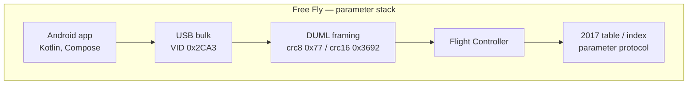
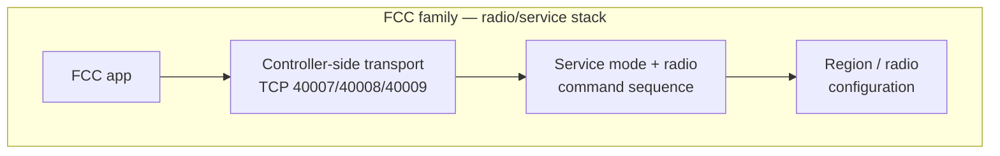
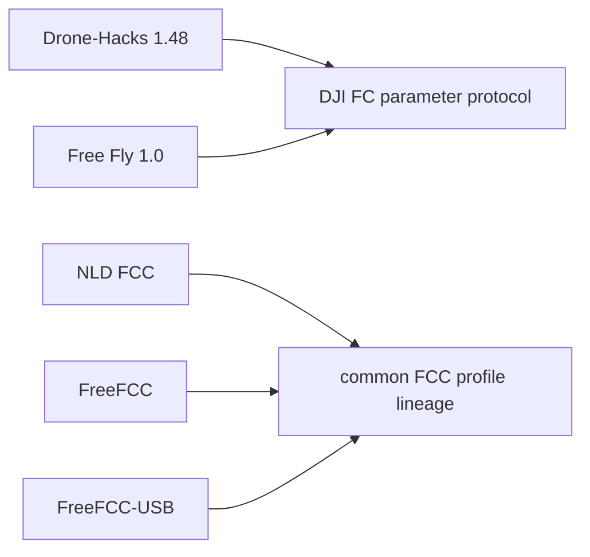

# DJI Free Fly 1.0 — DUML Protocol Research

A clean-room research project documenting the DJI protocol used by the **Free Fly
1.0** Android application, and providing an independent, **read-only-first**
implementation of it.

> **Static research complete. Hardware validation not yet performed.**
> Nothing in this repository has been sent to an aircraft. See
> [Known unknowns](#known-unknowns) and [`docs/HARDWARE_TEST_PLAN.md`](docs/HARDWARE_TEST_PLAN.md).

---

## What is this?

Free Fly (`com.dronehacks.app`, version 1.0) is an Android application that
talks to DJI hardware over USB. This project reverse-engineers the protocol it
speaks, documents it, and re-implements it independently as `flylib`.

**No proprietary APK, EXE or firmware is distributed here.** All analysis was
performed locally on samples obtained outside this repository.

---

## Main findings

**Free Fly is NOT a modified DJI Fly build.** It is a separate application:
package `com.dronehacks.app`, no DJI package name, no DJI resource namespace, no
inherited DJI code.

**Free Fly is an offline DJI Flight Controller parameter editor.** It has no
`INTERNET` permission, no HTTP client library anywhere in its ten DEX files, and
no vendor endpoint. It is an unreleased debug-signed build with no obfuscation.

**It implements its own Kotlin DUML stack** — about 15 hand-written classes,
with its own framing, checksums and framer.

**Current behaviour uses the 2017 table/index parameter protocol.**

**Its 2015 implementation exists but is dead code** in the analysed build:
`readAll2015` is unreachable (verified by call-site analysis across the whole
DEX tree), and `getParamInfo2015` / `writeParamValue2015` have **zero** callers.

**The write path is live**, reachable from the UI's edit dialog.

### Comparison with Drone-Hacks 1.48

Drone-Hacks implements strongly matching parameter-protocol semantics:

| | Result |
|---|---|
| Command IDs compared | **10 / 10 match** |
| Payload layouts compared | **6 / 6 match** |
| Protocol lineage | **HIGH** |
| Direct code lineage | **LOW** |
| Direct copying evidence | **NONE** |

The shared constants (`crc8` init `0x77`, `crc16` init `0x3692`, length mask
`0x3FF`, parameter-hash modulus `0xFFFFFFFB`) are **strong independent
validation** of the Free Fly protocol recovery — but only **LOW** evidence of
code lineage, because a third, independent public project (`djiparam`) contains
the same values. They are **separately implemented codebases** converging on
DJI's protocol, not shared source.

### The FCC tools are a different subsystem

NLD FCC, FreeFCC and FreeFCC-USB use a **separate controller-side FCC mechanism**
— service mode and radio/channel configuration — reached through the
controller's local TCP service. Their recovered **21-frame FCC profile is
byte-identical** where verified (NLD / FreeFCC / FreeFCC-USB; a 4-frame keepalive
also matches between NLD and FreeFCC).

Free Fly and the FCC tools therefore **affect different DJI subsystems**, even
where a user-visible effect could overlap: Free Fly writes flight-controller
parameters, while the FCC tools reconfigure the radio.







---

## Clean-room library — `flylib`

`research/flylib` is an independent implementation. It does not link against,
decompile from, or embed any part of the analysed application.

| Module | Purpose |
|---|---|
| `crc` | CRC-8 (poly `0x8C`, init `0x77`) and CRC-16 (X-25 family, init `0x3692`) |
| `packet` | DUML header/payload encode and decode |
| `parser` | streaming byte framer with resynchronisation |
| `commands` | one builder per recovered request type |
| `params` | FC parameter type table and value codecs |
| `selection` | 2015/2017 protocol-selection policy |
| `transport` | replay, scripted, dry-run and live transports |
| `snapshot` | parameter snapshot serialisation, import and comparison |
| `replay` | capture from a source, and replay a snapshot with no device |
| `guard` | **the mutation gate — disabled by default** |

**Mutation is disabled by default.** `MutationGuard` starts refused; enabling it
requires an explicit written reason, and enabling it still keeps the library in
dry-run unless `dry_run=False` is passed explicitly. Every transport enforces
this, so no code path can reach a device with a mutating frame.

```python
from flylib import ReplayTransport, ScriptedTransport, Session, commands
from flylib.guard import MutationGuard

# Read-only replay of a captured conversation: no hardware, no network.
session = Session(ReplayTransport.from_hexfile("capture.hex"))

# Dry run: render frames, transmit nothing.
dry = ScriptedTransport()
dry.send(commands.assistant_unlock(1))
```

---

## Status

| | |
|---|---|
| Static research | **COMPLETE** |
| Hardware validation | **NOT YET PERFORMED** |
| Test suite | 200 passing, 0 skipped with a sample present; 198 passing with repository contents alone |
| Proprietary binaries | **0** in the tree, **0** in the full history |

This distinction matters: the protocol described here is **recovered from
bytecode and verified against the application's own constants**, not from
observed traffic. Nothing here has been confirmed on an aircraft.

---

## Repository map

```
docs/                     17 research documents (start with docs/README.md)
research/flylib/          the clean-room library
research/reports/         per-sample analysis reports
research/generated/       machine-readable derived data (no bulk extracts)
research/corpus/          sample registry  (gitignored; samples not redistributed)
tools/                    analysis tooling (apktool/jadx wrappers, corpus builders)
tests/                    test suite, incl. fixtures/crc_tables_from_sample.json
```

---

## Quick start

Requires Python 3.11+ and `pytest`. Nothing else.

```bash
git clone https://github.com/Rezovovich/dji-freefly-research
cd dji-freefly-research

python -m venv .venv && source .venv/bin/activate     # Windows: .venv\Scripts\activate
pip install pytest

python -m pytest tests/ -q
```

The full suite runs from the repository contents alone — **no proprietary sample
is needed**. Two tests skip, and both are optional local-strengthening checks
(re-deriving a CRC fixture from a local decompile, and running the signing parser
against a real APK).

Inspect the derived data:

```bash
cat research/generated/freefly_commands.json     # the recovered command table
cat research/generated/command_corpus.json       # normalised FCC command corpus
```

Re-deriving the analysis from your own legally obtained samples is optional and
requires the toolchain:

```bash
bash tools/toolchain.sh                          # JDK, jadx, apktool into work/
# then place your sample at samples/FF_v_1_00.apk and run tools/baseline.py,
# tools/signing.py, tools/extract_duml_commands.py — see docs/README.md
```

`tools/toolchain.sh`, the decoded output and any placed sample all live under
`work/` and `samples/`, both gitignored.

---

## Research integrity

Conclusions in this repository are labelled **FACT**, **INFERENCE** or
**HYPOTHESIS**, and each names the artefact it came from.

Several intermediate findings were **wrong and were corrected in place**, at the
point where the original claim appears rather than only in a later document.
Three examples, kept visible deliberately:

- A truncated constant dump was written up as a finding (`ParamType` reported as
  8 entries; it is 12).
- `assets/advanced.json` was described as a parameter database; it is a
  human-verification quiz payload, and Drone-Hacks ships no parameter catalogue
  at all.
- A DEX string search for `com.wireguard` used the wrong separator and produced
  a plausible null result; DEX descriptors use `/`.

Items that could not be resolved are recorded as unresolved rather than filled
in — for example the table bound `readAll2017` iterates, and the interaction of
the `force` flag with the empty-result test.

---

## Known unknowns

- **No live hardware test.** The protocol is recovered from bytecode, not from a
  packet capture from an aircraft.
- **Persistence of relevant real-device writes is unknown.** Whether a `0xE3`
  parameter write survives a power cycle has not been tested.
- **RedFly's artifact was unavailable.** Its download endpoint is CSRF-gated and
  session-bound; no artifact was obtained, so all RedFly statements come from
  the vendor's own published page bundle.
- **`PKDS` (`0x504B4453`) remains unclassified** — a 4,277-byte, high-entropy
  block under a non-AOSP identifier. No meaning was assigned to it.
- The join between Free Fly's flat catalogue index space and the protocol's
  `(table, index)` addressing was never traced.

---

## Documentation

Start with [`docs/README.md`](docs/README.md). Recommended order:

1. [`docs/FINAL_REPORT.md`](docs/FINAL_REPORT.md) — what Free Fly is
2. [`docs/ARCHITECTURE.md`](docs/ARCHITECTURE.md) — how it is built
3. [`docs/COMPARATIVE_REPORT.md`](docs/COMPARATIVE_REPORT.md) — how it compares

## Safety

This is research software. See [`SECURITY.md`](SECURITY.md). The default
implementation is read-only, mutation is disabled by default, and flight-critical
or regulatory parameters require explicit caution.

## Licence

Not yet chosen — see [`docs/LICENSING.md`](docs/LICENSING.md) for the provenance
audit behind that decision.
