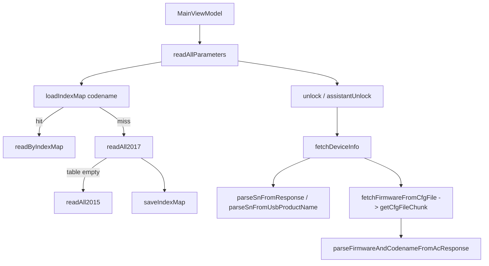

# Free Fly 1.0 — Architecture

How the app moves from a tap to a DUML frame, reconstructed from smali in
`work/apktool/decoded/smali_classes{4,5,6,7,8,9}/com/dronehacks/app/`.

Evidence labels are used throughout and mean what they mean in
`docs/PROVENANCE.md`: **FACT** (read from the bytecode, with the method named),
**INFERENCE** (concluded from facts, reasoning given), **HYPOTHESIS** (guess,
with what would settle it).

Method note: a full `jadx -d out <apk>` run loaded all 14,580 classes and
2,947,927 instructions and then spent 30+ minutes in codegen without emitting a
file. The app's own classes were then read directly from apktool smali, which is
both faster and the evidence level the project requires — decompiled Java is
explicitly not accepted for protocol constants.

---

## 1. The app is small, and that is the main finding

**FACT.** Of the 258 `com.dronehacks.app` classes, only about 15 are
hand-written. Everything else is Hilt/Dagger-generated
(`DaggerDroneHacksApp_HiltComponents_*`, `DroneHacksApp_HiltComponents$*`,
`Hilt_*`), Compose-generated (`ComposableSingletons*`), or Kotlin lambda
scaffolding (`$$ExternalSyntheticLambda*`, `$WhenMappings`, `$awaitPacket$1`).

The hand-written surface:

| Class | Role |
|---|---|
| `DroneHacksApp` | `@HiltAndroidApp`; sets up DI |
| `MainActivity` | `@AndroidEntryPoint`, Compose host; also the USB-attach target |
| `di.AppModule` | Hilt providers (`provideUsbSerialManager`, context) |
| `ui.screens.MainViewModel` | UI state holder; owns scan/read/write coroutines |
| `ui.screens.UiState` | immutable UI snapshot |
| `data.usb.UsbSerialManager` | USB enumeration, claim, read loop, diagnostics |
| `data.usb.UsbState` | `Connected` / `Disconnected` / `Error` / `WaitingPermission` |
| `data.repository.DroneRepository` | all protocol orchestration and caching |
| `data.repository.RepoResult` | `Success` / `Failure` result wrapper |
| `data.protocol.DumlBuilder` | frame construction + CRCs + sequence counter |
| `data.protocol.DumlParser` | single-shot frame validation |
| `data.protocol.DumlPacket` | data classes |
| `data.protocol.DumlHeader` | header model |
| `data.protocol.DumlConstants` | device/ack/cmdset/cmdid constants |
| `data.protocol.DroneCommands` | one method per request |
| `data.model.*` | `DroneInfo`, `DroneParameter`, `ParamDef`, `ParamType`, `ParamValueType`, `ParamCategory`, `ParamCatalog`, `ConnectionState` |

**INFERENCE.** This is a single-purpose tool, not a product with a feature set.
There is no settings screen, no account, no telemetry, no update path, no
plugin system — consistent with Stage 1's finding that the app has no network
capability at all.

---

## 2. Call graph

```
MainActivity (Compose)
  └─ MainViewModel                     StateFlow<UiState>
       ├─ DroneRepository              StateFlow<DroneInfo>, <parameters>, <progress>
       │    ├─ UsbSerialManager        StateFlow<UsbState>, SharedFlow<packets>, SharedFlow<diagLog>
       │    ├─ DroneCommands           builds request frames
       │    └─ DumlBuilder             encodes frames, crc8/crc16, nextSeq()
       └─ ParamCatalog                 reads assets/params_catalog.json
```

**FACT.** `MainViewModel` coroutine entry points recovered from the
`$$ExternalSyntheticLambda`/`$1` classes: `initDrone`, `readAllParameters`,
`readAllParametersInternal`, `refreshParameters`, `fetchParamValue`,
`setParameter`.

**FACT.** `DroneRepository` private suspend functions (the full protocol
surface): `awaitPacket`, `doUnlockForWrite`, `e2ReadValue`, `fetchDeviceInfo`,
`fetchFirmwareFromCfgFile`, `readAll2015`, `readAll2017`, `readByIndexMap`,
`unlock`, plus public `readAllParameters`, `writeParameter`,
`writeChangedParameters`, `writeDefaultValues`, `exportParameters`,
`importParameters`, `clearCache`.



---

## 3. USB layer — exact behaviour

**FACT**, from `UsbSerialManager.findAndConnect` and `startReadLoop$1`:

### Device and interface selection

1. Iterate `device.getInterfaceCount()`.
2. For each interface, iterate `getEndpointCount()`. Keep an endpoint when
   `getType() == 0x02` (`ENDPOINT_XFER_BULK`); `getDirection() == 0x80` selects
   the IN endpoint, anything else the OUT endpoint. **Later endpoints overwrite
   earlier ones**, so the *last* bulk IN/OUT pair on an interface wins.
3. If both an IN and an OUT endpoint were found:
   `claimInterface(iface, /* force = */ true)`.
   On failure the app logs `  claimInterface <n> FAILED, trying next` and
   continues to the next interface.
4. On success the two endpoint addresses are rendered as hex strings for the
   diagnostic log.

**FACT.** There is **no** CDC-ACM handling anywhere: no `UsbSerialManager` from
a serial library, no control transfer, no line-coding / baud-rate setup, no
`setInterface`. The app performs **raw USB bulk transfers**. This is a
notable and slightly surprising result — the app does not talk to a serial port
abstraction, it talks to bulk endpoints directly.

### Connection handshake

**FACT.** On entering the read loop the app writes a one-byte buffer
`byteArrayOf(0x30)` to the OUT endpoint **five times**, each with a **200 ms**
timeout:

```
bulkTransfer(epOut, [0x30], 0, 1, 200)   × 5
```

**INFERENCE.** `0x30` is ASCII `'0'`. A repeated single-character nudge is a
common way to make a device-side parser emit or flush state at link-up. What
the aircraft does with it is not determinable from this APK.

### Read path

**FACT.**

| Setting | Value |
|---|---|
| Read buffer | `0x200` = **512 bytes** |
| Read timeout | `0x7d0` = **2000 ms** |
| Write timeout | `0x7d0` = **2000 ms** |
| `_packets` SharedFlow | replay `0`, extra buffer capacity `0x100` = 256 |
| `_diagLog` SharedFlow | replay `0`, extra buffer capacity `0x200` = 512 |

**FACT.** Received bytes are appended to an `incomingBuffer: List<Byte>`.
Framing waits until the buffer holds at least **3** bytes before attempting a
parse, then coalesces into a new array.

**FACT.** `DumlParser.parse` is single-shot with **no resynchronisation**. It
returns a failed `ParseResult` on: buffer shorter than `0x0d` (13), first byte
not `0x55`, declared length exceeding the buffer, header-CRC mismatch, or
frame-CRC mismatch. There is no scan-forward for the next magic byte.

**INFERENCE.** The 3-byte threshold is the minimum needed to read the magic and
the length word. That the parser cannot resynchronise means a single corrupt
byte in the stream costs the app whatever it was waiting for; the clean-room
`flylib.StreamParser` adds resynchronisation precisely because it is the
practical thing to do on a real link, and that difference is documented in
`research/flylib/parser.py`.

### USB identifiers

**FACT.** From `res/xml/device_filter.xml` and `DroneRepository`:
vendor `0x2CA3` (11427, DJI), product IDs `0x10` (16), `0x18` (24), `0x20` (32).
`MainActivity` registers `USB_DEVICE_ATTACHED`, so the app auto-launches when a
matching device is attached.

---

## 4. Protocol selection — what is confirmed and what is not

**FACT.** `DroneRepository.readAllParameters(force: Boolean)` — decoded from
`DroneRepository.smali:9668-10086`:

```
codename = droneInfo.type                      // the AC's model codename
if (!force):
    map = loadIndexMap(codename)
    if map != null:
        diag("Cache hit for <codename>: N known indices — fast read")
        return readByIndexMap(map)             // log "Fast read done: N"
diag("Full scan for <codename> (first time)")
list = readAll2017()
diag("Scan done: N")
if (list.isEmpty() XOR force):                 // see caveat below
    saveIndexMap(codename, list)
return Success(list)
```

**FACT.** `readAll2017` iterates parameter tables, calling
`getTableAttribs2017(tableNo)` to learn each table's declared parameter count,
and contains the literal diagnostic string:

```
"Table " + tableNo + " empty or no response, falling back to 2015"
```

emitted when a table's declared count is zero. So **a 2017→2015 fallback
exists**, and it is driven per-table by an empty or unanswered
`getTableAttribs2017`.

**FACT.** `readAll2015` contains the literal string `"2015 EOL at index "`,
confirming the 2015 protocol is walked until an explicit end-of-list marker
rather than to a known count.

**FACT.** Index maps are cached under the filename suffix `_index_map.json`,
keyed by the aircraft codename (`DroneRepository.cacheFile`), with
`loadIndexMap` / `saveIndexMap` / `clearCache` as the accessors.

**Not pinned — stated rather than guessed.** The exact interaction between
`force` and the empty-list test at the end of `readAllParameters` is not
resolved here: the `XOR` operand that `isEmpty()` is combined with is a value
that may be the `force` flag or a size register, and the coroutine's state object
moves it through registers in a way that makes a one-line reading unsafe. The
*structure* — index-map fast path, else 2017 full scan, per-table fallback to
2015, then save the map — is confirmed. The precise `force` semantics are
**HYPOTHESIS** pending a cleaner read of that function, and no code in
`flylib` encodes a guess about them.

---

## 5. Concurrency, timeouts, matching, errors

**FACT.** Everything long-running is a coroutine. `DroneRepository`'s methods
are `suspend` and use `awaitPacket`, which collects the `packets` SharedFlow
with a timeout and applies a predicate to select the matching reply.

**FACT.** The two timeouts that are visible in the USB layer are 2000 ms for
both read and write transfers, and 200 ms for the connect-time init burst.

**FACT.** Errors are modelled explicitly: `UsbState.Error`,
`ConnectionState.Error` (`Searching` / `Connected` / `Disconnected` / `Error`),
and `RepoResult.Failure`, so failures are values rather than thrown exceptions
across the repository boundary.

**INFERENCE.** Because the packet flow is a hot `SharedFlow` with replay 0 and
a 256-slot buffer, a slow consumer can lose packets rather than block the read
loop. That is the right trade for a continuous telemetry-ish stream, and it
means a caller that stalls can silently miss a reply. The clean-room
`Session` keeps a single persistent parser per session for the same reason a
caller must not assume replies arrive whole.

---

## 6. State machines

**Connection** (`UsbState`): `Disconnected → WaitingPermission → Connected`,
with `Error` reachable from any step (permission refused, `openDevice` null, no
interface claims).

**Protocol selection** (`DroneRepository.readAllParameters`): index map hit →
fast read → return; otherwise full 2017 scan → per-table fallback → save map →
return.

**Parameter value lifecycle** (`UiState`): `DisconnectedPlaceholder` /
`LoadingScreen` / `MainScreen` with `DeviceInfoCard`, `DiagPanel`, `ParamCard`,
`EditParamDialog`, `TopBar`.

---

## 7. What the app does *not* contain

Stated explicitly because several are easy to assume from the "DJI hacking"
framing, and their absence is itself a finding:

- **FACT.** No RCLink framing, no `com.dji.logiclink` / `com.dji.protocol`
  classes, no local socket or loopback TCP transport.
- **FACT.** No radio-region, FCC profile, service-mode or C0 command anywhere in
  the fourteen builders in `DroneCommands`.
- **FACT.** No firmware container, patcher or flasher.
- **FACT.** Everything is **FC Assistant parameter protocol** over direct USB
  bulk.

**INFERENCE.** Free Fly is a parameter reader/editor for the flight controller
reached over USB, not an FCC/region tool. If it can affect region settings at
all, it would be by writing FC parameters — which is a different mechanism from
the FCC command sequences used by the tools in the comparative corpus. That
distinction is the central question for the comparative report and is carried
into Stage 7.